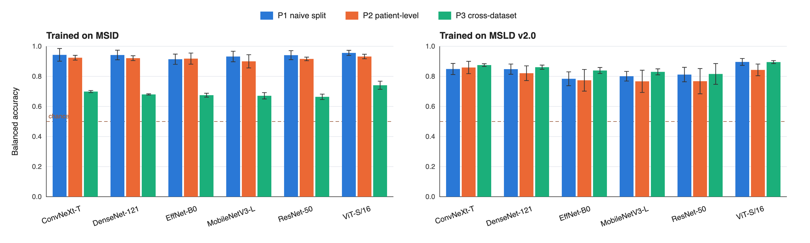

# How well do mpox skin-lesion classifiers generalize?

Code for a strict evaluation of deep-learning mpox classifiers: the same
models are tested under three protocols, after a duplicate audit of the data.

| Protocol | Test set | Purpose |
| --- | --- | --- |
| **P1 naive** | random image-level 70/20/10 split | the setup many papers use |
| **P2 patient-level** | official patient-independent folds (MSLD v2.0) or duplicate-group splits; no duplicate group crosses train and test | honest within-dataset score |
| **P3 cross-dataset** | train on one dataset, test on the other, minus duplicates of training images | closest proxy for new patients and cameras |

Also included: a perceptual-hash + embedding **duplicate audit** within and
across datasets, an approximate **skin-tone (ITA) breakdown**, and
**Grad-CAM** sheets for checking what the models look at.

> **Status:** experiments complete (Kaggle, Tesla T4, 14–20 October 2026): evaluation
> study (156 trainings), TALE method study (186), control study (72), FACTOR study
> (192) and the pre-registered external test on MCSI (108). Summary tables, per-run
> results, run logs and the Grad-CAM ratings are in `paper_results/`. The paper is in
> preparation; its main finding is a **disease-presence shortcut**: models trained with
> mostly healthy negatives learn "visible skin disease = mpox".

## Results at a glance

Binary task (mpox vs. non-mpox), balanced accuracy, mean over models.

| Finding | Number |
| --- | --- |
| Duplicate pairs shared between MSID and MSLD v2.0 | 67 (plus 21 within the datasets) |
| Inflation from a naive split (P1 − P2) | +1.9 points (MSID), +2.6 points (MSLD v2.0) |
| Trained on MSID: own test (P2) → MSLD v2.0 (P3) | 0.919 → 0.688 |
| Trained on MSLD v2.0: own test (P2) → MSID (P3) | 0.805 → 0.853 |
| MSLD v2.0 images called mpox by MSID-trained models | cowpox 95.5%, chickenpox 76.1%, HFMD 51.4% |
| Cross-dataset mpox sensitivity, dark vs. light skin (ITA) | 0.874 vs. 0.579 |
| Grad-CAM peak on the lesion (83 rated maps) | 55 lesion, 19 mixed, 9 off-lesion |
| MSID-trained ERM, AUROC mpox vs healthy / vs other diseases (MSLD v2.0) | 0.946 / 0.774 (shortcut gap 0.172) |
| MCSI mpox images that copy an MSLD v2.0 or MSID image (crop-aware audit) | 94 of 100 |
| MSID-trained ERM on clean MCSI: acne images called mpox | 72.7% (acne is in neither training set) |
| Same, with diseased-skin negatives (5 methods), pre-registered test | balanced accuracy 0.698 → 0.773–0.865, acne called mpox 33.7–40.2% |
| Predicts MCSI accuracy across 54 models: AUROC vs healthy / specificity on other diseases (MSLD v2.0) | Spearman ρ = 0.03 / 0.76 |



## Data

Both datasets are public and on Kaggle. Cite them if you use this code.

| Dataset | Kaggle | Original source |
| --- | --- | --- |
| MSLD v2.0 (755 images, 541 patients, 6 classes) | `joydippaul/mpox-skin-lesion-dataset-version-20-msld-v20` | Ali et al., Biomed. Signal Process. Control 98:106742 (2024); arXiv:2306.14169 |
| MSID (4 classes) | `dipuiucse/monkeypoxskinimagedataset` | Bala & Hossain, Mendeley Data, doi:10.17632/r9bfpnvyxr.6 |
| MCSI (external test only; 400 images) | downloaded by `scripts/18_external_mcsi.py` | Campana et al., Zenodo doi:10.5281/zenodo.8360076 (CC BY 4.0) |
| Fitzpatrick17k (extra training negatives) | e.g. `mobaswiralfarabi/fitzpatrick17k-original` | Groh et al., CVPRW 2021 |

Only original images are used; folders whose path contains `aug` are skipped
and augmentation is applied inside training folds only.

## Run it on Kaggle (free GPU)

1. Create a new Kaggle notebook. **Settings:** Accelerator = GPU, Internet = On.
2. **Add Input:** the two datasets above.
3. **One-cell run:** put this in a single cell, then use
   **Save Version → Save & Run All** so it runs in the background:

   ```
   !git clone -q https://github.com/MirRahibHussain/mpox-generalization.git && bash mpox-generalization/run_all.sh
   ```

   `run_all.sh` finds the datasets, runs every step (smoke test first), and
   writes `key_results/` and `outputs.zip` to `/kaggle/working`.
4. **Step-by-step instead:** import `notebooks/kaggle_run.ipynb`
   (File → Import Notebook), set `REPO_URL`, and run the cells in order.

## Method study: TALE

TALE (Tone-Aware Look-alike Exposure) targets the two failures found above:

- look-alike exposure: 1,195 images of 24 papulovesicular, pustular, bullous or crusted
  conditions from Fitzpatrick17k are added as extra non-mpox training images (never used for
  validation or testing; duplicates of study images removed);
- tone-balanced sampling: every (class, skin-tone band) group is drawn equally often;
- tone-shift augmentation: the healthy skin around a lesion is moved to a random ITA band
  while the lesion is left unchanged.

It is compared with standard fine-tuning (ERM), hue/saturation jitter, mixup and Group DRO, plus
two ablations, on the same cross-dataset splits (ResNet-50, EfficientNet-B0, ViT-Small/16;
3 seeds per direction; Kaggle, Tesla T4, 186 trainings in 331 min, 18 October 2026).

| Balanced accuracy (P3), mean of 9 runs | MSID → MSLD v2.0 | MSLD v2.0 → MSID |
| --- | --- | --- |
| ERM | 0.703 | 0.859 |
| Colour jitter / Mixup / Group DRO | 0.706 / 0.714 / 0.691 | 0.863 / 0.837 / 0.852 |
| Look-alike exposure only | 0.755 | 0.849 |
| Tone balancing + tone shift only | 0.695 | 0.846 |
| **TALE** | **0.749** (8 of 9 runs better than ERM, p = 0.008) | 0.837 |

In the harder direction TALE cut the share of hand, foot and mouth disease images called mpox
from 45% to 19%. The ablation shows that the added images produce the gain; the skin-tone
components did not meaningfully narrow the dark-versus-light sensitivity gap. Full tables, per-run results
and statistics (bootstrap CIs, Holm-adjusted Wilcoxon tests) are in `paper_results/tale/`.

### Control study: do the added images need to look like mpox?

A third session (19 October 2026, 72 trainings, 182 min) re-ran ERM, look-alike exposure and TALE
next to a **random-negative control**: 1,195 Fitzpatrick17k images drawn at random from 90 other
conditions (no pox, herpes, blister, vesicle or pustule names), matched to the look-alike pool in
every Fitzpatrick type. It also saved validation predictions for threshold analysis and measured
the tone shift on 360 study images.

| MSID → MSLD v2.0, mean of 9 runs | Bal. acc. | Specificity | AUROC | HFMD called mpox |
| --- | --- | --- | --- | --- |
| ERM | 0.701 | 0.476 | 0.811 | 45.5% |
| Look-alike exposure only | 0.744 | 0.633 | 0.836 | 18.5% |
| Random-negative control | 0.757 | 0.673 | 0.845 | 17.5% |
| **TALE** | **0.752** (9 of 9 runs better than ERM, Holm-adjusted p = 0.023) | 0.653 | 0.842 | 16.6% |

- TALE's gain repeated (+5.1 points, after +4.6 in the method study).
- Random diseased-skin negatives helped at least as much as look-alikes (look-alike − control =
  −1.3 points, 95% CI −3.2 to +0.5): the choice of look-alike conditions did not measurably matter.
- With a threshold chosen on validation data for 90% sensitivity, the gain over ERM shrank to about
  3 points; AUROC stayed 2.4–3.4 points higher.
- The tone shift reached its target ITA band in 92.2% of shifts; lesion pixels changed by a median of
  1.9 L* units against 13.1 for healthy skin.

Files: `paper_results/control/`. To reproduce on Kaggle (same inputs as above):

```
!git clone -q https://github.com/MirRahibHussain/mpox-generalization.git && bash mpox-generalization/run_control.sh
```

Code: `src/mpoxgen/methods.py`, `src/mpoxgen/external.py`, `scripts/08`-`10`. On Kaggle, add the
Fitzpatrick17k images (e.g. `mobaswiralfarabi/fitzpatrick17k-original`) as a third input and run:

```
!git clone -q https://github.com/MirRahibHussain/mpox-generalization.git && bash mpox-generalization/run_methods.sh
```

`python tests/run_method_checks.py` checks the method code on synthetic images.

## FACTOR: a factorized, atlas-conditioned classifier

The control study suggested that what an mpox model trained on mostly healthy negatives lacks is
the notion that *visible skin disease* is not the same as *mpox*. FACTOR (Factorized,
Atlas-Conditioned Training for Open-set Robustness, `src/mpoxgen/factor.py`) builds this into the
model:

- **Factorized head.** One backbone, two logits: "is any skin disease visible?" (trained on all
  images; healthy study images are its negatives) and "is the disease mpox?" (trained on diseased
  images only, mpox against every other disease). A case is called mpox when the geometric mean of
  the two class-balanced probabilities is at least 0.5.
- **Condition-diverse atlas exposure.** Negatives come from the whole Fitzpatrick17k atlas (all
  conditions except the evaluation classes, duplicates of study images removed); a new subset of
  1,195 images is drawn every epoch, uniform over conditions.
- **Tone matching.** Draw weights are rescaled so the ITA-band mix of the atlas negatives equals
  that of the mpox training images.

Compared on P3 with ERM, the random-negative control, a flat head on the same atlas draws, HOD
(Roy et al., *Med. Image Anal.* 2022) and two ablations (no tone matching; static control pool),
plus a condition-diversity test (5 / 20 / all conditions), an ITA-vs-annotated-Fitzpatrick check of
the skin-tone proxy (`scripts/16`), an open-set analysis of seen vs unseen negative classes
(`scripts/17`) and P2 runs. Deterministic cuDNN kernels (`MPOXGEN_DETERMINISTIC=1`).

```
!git clone -q https://github.com/MirRahibHussain/mpox-generalization.git && bash mpox-generalization/run_factor.sh
```

**Results** (20 October 2026, 192 trainings, 418 min; `paper_results/factor/`):

| P3, mean of 9 runs | MSID → MSLD v2.0 bal. acc. | AUROC | Shortcut gap | MSLD v2.0 → MSID bal. acc. |
| --- | --- | --- | --- | --- |
| ERM | 0.702 | 0.813 | 0.172 | 0.847 |
| Random-negative control | 0.738 | 0.831 | 0.106 | 0.849 |
| Atlas, flat head | 0.750 | 0.841 | 0.114 | 0.843 |
| HOD | **0.770** | **0.859** | 0.110 | 0.848 |
| FACTOR head, static pool | 0.740 | 0.838 | 0.131 | 0.850 |
| FACTOR without tone matching | 0.761 | 0.852 | 0.129 | 0.843 |
| FACTOR | 0.750 | 0.846 | 0.122 | 0.847 |

FACTOR was **not** better than the simpler atlas head (+0.0 points, 95% CI −1.7 to +1.6) and was
2.1 points below HOD; tone matching produced the intended negative mix but did not help. Every
configuration with diseased negatives beat ERM in the harder direction (3.6–6.9 points) and narrowed
the shortcut gap by about a third; none closed it. Atlas draws from 5, 20 or all 114 conditions gave
0.748, 0.729 and 0.746 (ResNet-50, 3 seeds): no sign that many conditions are needed. ITA agreed only
moderately with annotated Fitzpatrick type (Spearman ρ = −0.487, weighted κ = 0.345).

### External test on a third dataset (MCSI), pre-registered

`PREREGISTRATION_MCSI.md` fixes the data cleaning, methods, hypotheses and statistics before any
model sees MCSI (Mpox Close Skin Images, Campana et al.; Zenodo 8360076, CC BY 4.0; 400 images:
mpox, chickenpox, acne, healthy). `scripts/18_external_mcsi.py` downloads it and removes every image
that copies an MSLD v2.0 or MSID image, with a crop-aware audit (pHash/dHash, embedding similarity,
and ORB keypoints with a RANSAC homography for cropped and zoomed copies). `scripts/19_external_eval.py`
reports accuracy, the share of acne called mpox and the *disease-presence shortcut*: AUROC of the
mpox score against healthy skin minus AUROC against other diseases.

```
!git clone -q https://github.com/MirRahibHussain/mpox-generalization.git && bash mpox-generalization/run_external.sh
```

**Results** (20 October 2026, 108 trainings, 326 min; `paper_results/external/`). The crop-aware audit
removed 106 of 399 unique MCSI images, including **94 of the 100 mpox images** (copies of MSLD v2.0
or MSID images), leaving 293 clean images (6 mpox). Pre-registered primary test, models trained on MSID:

| Method (9 runs each) | Bal. acc. | Acne called mpox | Chickenpox called mpox | Healthy called mpox | Shortcut gap |
| --- | --- | --- | --- | --- | --- |
| ERM | 0.698 | 72.7% | 69.7% | 38.0% | 0.134 |
| Random-negative control | 0.816 | 33.7% | 44.6% | 21.0% | 0.085 |
| Atlas, flat head | 0.835 | 34.6% | 45.4% | 18.6% | 0.113 |
| HOD | **0.865** | 34.0% | 36.5% | 9.8% | 0.088 |
| FACTOR without tone matching | 0.795 | 40.2% | 46.1% | 25.1% | 0.125 |
| FACTOR | 0.773 | 37.4% | 47.9% | 28.4% | 0.114 |

- **H1** (higher balanced accuracy than ERM) and **H2** (fewer acne images called mpox): supported for all
  five methods (Holm-adjusted p ≤ 0.039).
- **H3**: ERM's gap is positive (p = 0.0039); only the random-negative control had a significantly smaller gap.
- **H4** (FACTOR vs the others, no direction predicted): FACTOR was never better; its AUROC was lower than the
  atlas head's (adjusted p = 0.047).
- Secondary: for MSLD v2.0-trained models no method beat ERM; on the direction-specific clean sets of
  amendment 1 (34 mpox images), H1 again held for all five MSID-trained methods.
- Exploratory: across the 54 MSID-trained models, AUROC against healthy skin on MSLD v2.0 did not predict
  balanced accuracy on MCSI (ρ = 0.03), specificity on MSLD v2.0's other diseases did (ρ = 0.76).

Note on amendment 1: it describes most removed mpox images as cropped copies found only by ORB. That holds
for the flagged *pairs* (88 of 204 pairs were ORB-only); per *image*, 95 of the 106 removed images also had a
hash or embedding match, and 11 were found only by ORB. All 204 flagged pairs had the same class on both sides.
## Pipeline

```bash
pip install -r requirements.txt

# 1. index (one row per unique file; official folds kept)
python scripts/01_build_index.py --data msld_v2=PATH_TO_MSLD --data msid=PATH_TO_MSID
# 2. (GPU, optional) embedding near-duplicates -> review embedding_review_sheet.png
python scripts/02_embedding_pairs.py
# 3. duplicate audit (hash + accepted embedding pairs) and ITA skin tone
python scripts/03_duplicate_audit.py
# 4. P1/P2/P3 splits + leakage check (fails loudly if P2/P3 leak)
python scripts/04_make_splits.py
# 5. (GPU) train/evaluate; resumable; --smoke for a 1-epoch test
python scripts/05_run_experiments.py --tasks binary --save-ckpt
# 6. tables + figure for the paper
python scripts/06_summarize.py
# 7. Grad-CAM sheets (CNNs), then fill the 'attention' column by eye
python scripts/07_gradcam.py --run results/binary_P3_msld_v2_to_msid_rep0/resnet50
# 8-11. TALE method study and control: see run_methods.sh and run_control.sh
# 12. tone-shift check on study images (CPU)
python scripts/12_tone_shift_check.py --index data/index --out results_control
# 13. paired statistics per direction: bootstrap CIs, exact Wilcoxon, Holm correction
python scripts/13_paired_stats.py --runs results_control/all_runs.csv --pairs la:erm rand:erm tale:erm la:rand tale:rand tale:la
# 15-17. FACTOR study: whole-atlas pool, ITA vs Fitzpatrick check, open-set analysis (see run_factor.sh)
# 18-19. external MCSI test set with crop-aware duplicate audit, and its analysis (see run_external.sh)
# 14. blinded Grad-CAM rating by people, then Cohen's kappa between raters
python scripts/14_gradcam_rating_kit.py make --results results --ratings paper_results/gradcam_ratings.csv --out gradcam_blind
python scripts/14_gradcam_rating_kit.py agree --key gradcam_blind/key.csv --sheets rater_A.csv rater_B.csv --ai paper_results/gradcam_ratings.csv
```

Models (timm, ImageNet-pretrained): ResNet-50, DenseNet-121, EfficientNet-B0,
MobileNetV3-Large, ConvNeXt-Tiny, ViT-Small/16. Training: 224 px, AdamW,
cosine schedule, up to 30 epochs, early stopping on validation balanced
accuracy (patience 7), class-weighted cross-entropy, mild brightness/contrast
jitter only (no hue change, so skin tone is not altered).

## Outputs

| File | Content |
| --- | --- |
| `data/index/duplicate_summary.csv` | duplicate counts within and across datasets |
| `data/index/cross_dataset_duplicates.png` | contact sheet of cross-dataset duplicates |
| `splits/*.json`, `splits/manifest.csv` | every split, reusable by others |
| `results/<split>/<model>/predictions.csv` | per-image predictions |
| `results/summary_by_model.csv` | mean ± sd per model and protocol |
| `results/inflation_gap.csv` | P1 − P2 (inflation) and P2 − P3 (generalization gap) |
| `results/ita_breakdown.csv` | mpox sensitivity/specificity per skin-tone band |
| `results/fig_protocols.png` | balanced accuracy by protocol |

## Checks

`python tests/run_cpu_checks.py` builds two synthetic datasets with planted
duplicates and checks indexing, the duplicate audit, ITA, split leakage and
the summary step on CPU. `python tests/run_method_checks.py` does the same for
the TALE and FACTOR code (atlas pool, draw weights, epoch sampler, ITA check, open-set analysis),
the control pool, operating points and paired statistics. Neither
trains real models or produces research results.

## Limitations to keep in mind

- Both datasets are web-collected, not clinical cohorts.
- MSID has no patient IDs; its P2 splits group duplicates only.
- ITA from web photos without lesion masks is an approximate skin-tone proxy.

## Citation

If you use this code, please cite the paper (details to be added) and the two
datasets above.

## Acknowledgment of AI assistance

An AI assistant (Claude, Anthropic) drafted the code, designed and implemented
the TALE method, its random-negative control and the FACTOR method after the author chose their direction, set up and launched the
Kaggle runs, rated the Grad-CAM maps in `paper_results/gradcam_ratings.csv`,
and drafted the manuscript. The author is responsible for the study and its
results.

## License

MIT - see `LICENSE`.
